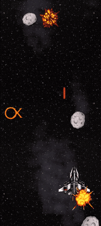

# J2DGameEngineAndroid

Projeto de faculdade, apresentado nas matérias Programação de Jogos Mobile e Programação Avançada em C++ e Java. Nasceu porque desenhar sprites pelo caminho comum do Android, com `View` e `Canvas`, ficava lento demais para um jogo. Em vez de adaptar um motor pronto, o desenho, o loop e as entidades foram feitos do zero em cima de OpenGL ES 1 (`GLSurfaceView`).

O código é de quem estava aprendendo: direto, com pouca abstração e com as marcas de um trabalho de curso. Ainda assim o motor roda de verdade. Carrega textura, anima sprite, lê o toque, desenha texto a partir de uma fonte e separa o desenho em camadas. O jogo incluso é uma nave destruindo asteroides, com o combo e o FPS escritos na tela.

O código do app está em Java 17. O pacote é `com.posixprotogen.j2dgameengine`.

## Demonstração prática



É um jogo de nave. Asteroides descem pela tela e o objetivo é destruir o maior número possível, atirando neles. Cada asteroide destruído soma um no contador. Se um asteroide acerta a nave, o contador volta para zero.

Segurar o dedo em cima da nave move ela e mantém o tiro. Soltar para o disparo. O fundo rola enquanto os asteroides continuam aparecendo, então a partida não tem fim: a meta é sustentar a sequência.

`J2DGameEngineMain` carrega as texturas e os sons e coloca `SpaceShipMain` no motor. `CollisionCore` compara os tiros e a nave com os asteroides. `Hud` carrega duas fontes e escreve o combo e o FPS.

## Música

A música da partida é **The Spaceship Is Ready**, composta por Alfred Louis Piper (eu). No jogo o arquivo é `musics/The_spaceship_is_ready.mp3`. A faixa também está no SoundCloud: [The Spaceship Is Ready](https://soundcloud.com/asuc0rplabs/the-spaceship-is-ready).

## Como fazer um jogo

O jogo começa em `J2DGameEngineMain.setupGame`. O motor chama esse método uma vez, quando a superfície OpenGL abre. Ali se registram os arquivos e entra a primeira entidade. O resto nasce a partir dela.

Os arquivos ficam em `app/src/main/assets`. Textura é PNG. Efeito curto é WAV, OGG ou MP3 pequeno. Música é OGG ou MP3. O nome no código é o caminho dentro de `assets`, como `ship.png` ou `sounds/laser_shot.wav`.

```java
public void setupGame(GameContext gameContext) {
    SpriteLoader sprites = gameContext.getSpriteLoader();
    sprites.addTexture("ship.png");
    sprites.addTexture("explosionb.png", 4, 4);

    gameContext.getSoundPlayer().addSound("sounds/laser_shot.wav");

    gameContext.addEntity(new SpaceShipMain());
}
```

`addTexture` com dois números corta a imagem numa grade, da esquerda para a direita e de cima para baixo. No exemplo, `explosionb.png` tem 4 colunas e 4 linhas. `getTexture` devolve uma cópia, então o `resize` de uma entidade não altera o sprite de outra.

Cada peça estende `AbstractEntity` e preenche `setup`, `update` e `draw`. O motor guarda o `GameContext` na entidade antes do `setup`. Nos três métodos o acesso é `getGameContext()`.

```java
public class Asteroid extends AbstractEntity {
    private GLSprite sprite;
    private float x;
    private float y = 0f;

    @Override
    public void setup() {
        sprite = getGameContext().getSpriteLoader().getTexture("asteroidb.png");
        sprite.resize(0.15f);
    }

    @Override
    public void update() {
        y += 0.4f * getGameContext().getLastFrameTime();
        if (y > 1f) {
            die();
        }
    }

    @Override
    public void draw() {
        getGameContext().getJ2DCanvas().submit(Layer.WORLD, sprite, x, y);
    }
}
```

`setup` roda uma vez. `update` e `draw` rodam todo frame, nessa ordem. O `draw` não pinta na hora. Ele só emite um comando. Quando toda entidade já emitiu, o motor desenha os buckets de trás para a frente. Uma entidade criada com `addEntity` dentro do `setup` de outra só recebe o próprio `setup` no frame seguinte.

### Camadas

A ordem de quem fica na frente não é mais a ordem em que a entidade entrou no mundo. É a `Layer` passada no `submit`. O fundo pode nascer depois da nave e continuar atrás, se for emitido numa camada mais funda.

Cada constante de `Layer` é um bucket. Os buckets são desenhados nesta ordem, do primeiro ao último. Dentro de um bucket, vale a ordem de entrada daquele quadro: o que foi emitido primeiro fica atrás. Não há reordenação no fim do frame. Trocar um sprite de camada é passar outra constante no próximo `submit`.

A mesma entidade pode emitir em duas camadas. Uma árvore manda o tronco em `WORLD_BACK` e a copa em `WORLD_FRONT`. A nave, em `WORLD`, fica no meio.

```java
J2DCanvas canvas = getGameContext().getJ2DCanvas();
canvas.submit(Layer.WORLD_BACK, trunk, x, y);
canvas.submit(Layer.WORLD, ship, x, y);
canvas.submit(Layer.WORLD_FRONT, canopy, x, y);
```

| Camada | O que entra |
|---|---|
| `BACKGROUND_FAR` | Paralaxe distante: céu, estrelas, lua |
| `BACKGROUND` | Fundo do meio: nuvens, a segunda faixa que rola |
| `BACKGROUND_NEAR` | Fundo colado no chão: prédios distantes, mata atrás dos tiles |
| `GROUND` | Tiles, plataformas, estrada |
| `DECAL` | Marca no chão, por baixo de qualquer ator: rachadura, pegada |
| `SHADOW` | Sombra debaixo de quem a projeta |
| `WORLD_BACK` | O que o ator cobre: tronco, muro baixo, balcão |
| `WORLD` | Atores e itens. Nave, asteroide, inimigo, caixa |
| `PROJECTILE` | Tiro. Fica na frente de quem disparou e atrás da copa |
| `WORLD_FRONT` | O que cobre o ator e o tiro: copa, beiral, folhagem |
| `EFFECT` | Explosão, impacto, flash de um ator |
| `PARTICLE` | Faísca, fumaça, poeira |
| `GLOBAL_EFFECT` | Efeito sobre o cenário inteiro: chuva, onda de choque, flash de dano. O placar continua na frente |
| `WORLD_UI` | Texto preso ao mundo: dano subindo, barra sobre o inimigo, nome |
| `HUD` | Interface presa à tela: placar, vida, minimapa, combo |
| `HUD_FRONT` | O que cobre o HUD: tooltip, cursor, ícone arrastado |
| `MENU` | Pausa, inventário, diálogo em tela cheia |
| `OVERLAY` | A última coisa: fade, letterbox, vinheta |

No jogo de exemplo o fundo e as estrelas distantes vão em `BACKGROUND_FAR`, a faixa de estrelas mais rápida em `BACKGROUND`, a nave e o asteroide em `WORLD`, o laser em `PROJECTILE`, a explosão em `EFFECT` e o texto em `HUD`.

### Texto

A fonte é um arquivo em `app/src/main/assets`. O caminho no código é o caminho dentro de `assets`. `loadFont` lê o arquivo uma vez e recorta cada letra num sprite branco. `create` copia esse atlas para um `TextSprite`. Sem o `loadFont` antes, o `create` lança `IllegalStateException`.

```java
@Override
public void setup() {
    TextLoader text = getGameContext().getTextLoader();
    text.loadFont("fonts/Orbitron-Bold.ttf");

    score = text.create("fonts/Orbitron-Bold.ttf");
    score.setSize(0.08f);
    score.setSpacing(0.01f);
    score.setTint(GLTint.modulate(0.2f, 1f, 0.4f, 1f));
}

@Override
public void update() {
    score.setText(getGameContext().getFps());
}

@Override
public void draw() {
    getGameContext().getJ2DCanvas().submit(Layer.HUD, score, 0.02f, 0.05f);
}
```

`setText` monta as letras. Pode receber `String` ou `Integer`. O `create` não chama `setText`: até a primeira chamada, não há nada para desenhar. Um caractere que não está no atlas é pulado. O atlas vai do espaço (`32`) até `ÿ` (`255`) e não inclui os controles `127` a `159`. Euro, aspas curvas e travessão não estão nessa faixa.

O `x` e o `y` do `submit` são o começo da primeira letra, no mesmo espaço do sprite. Cada letra anda a própria largura mais o `spacing`. Com `spacing` zero as letras se encostam, porque o recorte cola na tinta e não guarda o espaço lateral da fonte. `setSize(1)` deixa o lado maior da letra do tamanho da altura da tela. `0.08` é um texto de HUD. `0.02` é um texto pequeno, como o FPS do exemplo.

A letra nasce branca. `GLTint.modulate` multiplica essa cor. `modulate(1, 1, 1, 1)` mantém o branco. `modulate(1, 0, 0, 1)` pinta de vermelho. Um canal acima de 1 é cortado em 1, então a tinta não clareia uma letra que já é branca: ela só filtra.

As letras de uma mesma frase compartilham o `y` do `submit`, no centro do retângulo de cada glifo, não numa linha de base. Um `g` e um `b` não sentam no mesmo chão.

Fontes incluídas, todas em `fonts/`, com licença SIL OFL. A da Orbitron está em `fonts/OFL.txt`. As outras estão em `fonts/licenses/`.

| Arquivo | Uso |
|---|---|
| `fonts/Orbitron-Bold.ttf` | Letreiro de nave. É a do combo |
| `fonts/Audiowide-Regular.ttf` | Título largo |
| `fonts/Michroma-Regular.ttf` | Geométrica |
| `fonts/Iceland-Regular.ttf` | Angular. É a do FPS |
| `fonts/RussoOne-Regular.ttf` | Bloco pesado |
| `fonts/ZenDots-Regular.ttf` | Pontilhada |
| `fonts/ShareTechMono-Regular.ttf` | Mono de painel |
| `fonts/BlackOpsOne-Regular.ttf` | Estêncil |
| `fonts/Electrolize-Regular.ttf` | Fina |
| `fonts/Aldrich-Regular.ttf` | Quadrada |
| `fonts/Wallpoet-Regular.ttf` | Bloco retrô |
| `fonts/TurretRoad-Regular.ttf` | Painel |
| `fonts/ChakraPetch-Regular.ttf` | Interface |
| `fonts/Gruppo-Regular.ttf` | Traço fino |
| `fonts/Quantico-Regular.ttf` | Militar compacta |
| `fonts/Rajdhani-Medium.ttf` | Sans de interface |
| `fonts/BrunoAce-Regular.ttf` | Larga |

### O que o GameContext oferece

`getLastFrameTime` é a duração do frame anterior, em segundos. A velocidade multiplicada por esse valor acompanha a taxa de quadros.

`getDisplay` é a área visível. `width` é a razão largura/altura da tela. `height` é 1. O x cresce para a direita, de 0 até `width`. O y cresce para baixo, de 0 no topo até 1 embaixo. A nave do exemplo usa `width * 0.5` no x e fica perto de `0.8` no y.

`addEntity` coloca uma entidade na fila do mundo. `die()` marca a entidade como morta: ela deixa de atualizar e de desenhar na hora, e sai das listas no começo do frame seguinte. `removeEntity` faz essa mesma saída.

`getEntities(Asteroid.class)` devolve as entidades daquela classe exata. Uma subclasse fica na lista da própria classe. Quem morreu neste frame ainda pode aparecer na lista até o próximo.

`addTouchListener` registra um `GestureListener`: `onDown`, `onUp` e `onMoving`. O x e o y já estão no mesmo espaço do `submit`.

`getSpriteLoader` carrega e entrega as texturas. `addTexture` fica no `setupGame`. `getTexture` e `resize` ficam no `setup` da entidade. Numa grade, `nextSprite` avança o quadro e devolve verdadeiro quando a animação volta ao primeiro.

`getTextLoader` carrega a fonte e cria o `TextSprite`. O uso está em [Texto](#texto).

`getJ2DCanvas` recebe o desenho. `submit(camada, sprite, x, y)` emite um sprite. `submit(camada, texto, x, y)` emite as letras já montadas por `setText`. Os dois esperam o fim do `draw` de todas as entidades. `drawRect` ainda pinta no momento da chamada, antes dos buckets, então o sprite emitido cobre o retângulo. `GLRect.intersect` compara dois retângulos.

`getSoundPlayer` toca o áudio.

- `addSound` no `setupGame`, uma vez por arquivo. `playSound(arquivo, volume)` no evento, como no `setup` do tiro. Tocar no mesmo instante do `addSound` pode sair mudo: o carregamento termina um pouco depois.
- `playMusic(arquivo, volume, repetir, segundo)` começa a faixa. Com `repetir` verdadeiro ela entra em loop. `segundo` é o ponto da primeira entrada. Na volta, a faixa recomeça no instante 0.
- O volume vai de 0 a 1. Um valor acima de 1 toca como 1.
- `pause`, `resume` e `release` estão no `SoundPlayer`. A `MainActivity` ainda não os chama, então a música segue se o app for para segundo plano.

## Ferramentas

O código é escrito no Android Studio, em Java 17. O build usa Gradle 9.6.0 e o Android Gradle Plugin 9.4.0. O `compileSdk` e o `targetSdk` são 36. O `minSdk` é 24, que é o Android 7.0.

O desenho passa pelo OpenGL ES 1, no `GLSurfaceView` do SDK. A activity usa AndroidX, `appcompat` e `activity`. O versionamento é Git.

O Gradle 9.6 precisa de um JDK que ele consiga rodar. O JDK que vem com o Android Studio serve. Um JDK novo demais, como o 27, o Gradle recusa e o build nem começa.

## Como rodar

Abre a pasta do projeto no Android Studio e espera o Gradle sincronizar. O módulo executável é `app`. A configuração de execução também se chama `app`.

Requisitos:

- Android Studio com Android SDK 36
- JDK 17 ou mais novo para o Gradle (o JDK que vem com o Android Studio serve)
- Aparelho ou emulador com Android 7.0 (API 24) ou mais novo

## APK

Debug, para instalar direto:

```
./gradlew :app:assembleDebug
```

O arquivo fica em `app/build/outputs/apk/debug/app-debug.apk`.

No Android Studio: **Build → Generate App Bundles or APKs → Build APK(s)**.

O tipo `release` existe, mas o projeto não tem chave de assinatura. Para um APK de produção que instale no aparelho, usa **Build → Generate Signed App Bundle or APK**.

## Estrutura

| Pasta | Função |
|---|---|
| `core` | `GameEngine`, `GameWorld`, `GameContext`, superfície OpenGL |
| `core.entity` | `AbstractEntity`: `setup`, `update`, `draw` |
| `core.render` | `J2DCanvas`, camadas, sprite, texto e vetor |
| `core.assets` | `SpriteLoader`, `TextLoader`, `SoundPlayer` |
| `core.input` | Toque |
| `J2DGameEngineMain` | Inicialização do jogo |
| `spaceshipgame` | Jogo de exemplo |
| `app/src/main/assets` | PNG, `sounds/` e `musics/` |

O passo a passo de um jogo novo está em [Como fazer um jogo](#como-fazer-um-jogo).

## Futuro

Quero passar o desenho para OpenGL ES 3. Hoje está no ES 1, com `glTranslate`, `glRotate` e o vértice mandado pelo cliente. No ES 3 isso some, e eu ainda não faço ideia de como fazer a troca. Sei que o miolo é o `J2DCanvas` e o `RendererEngine`, e que textura, entidade e camada devem continuar. O `minSdk` 24 só promete ES 2, mas o emulador daqui e quase todo celular dessa época já têm ES 3. Pedir OpenGL 4.6 de PC num app Android não tem como.

A nave ainda é uma tech demo pela metade. Ela atira, colide, explode, conta o combo e toca a música. A ideia é fechar um ciclo: menu, um level, pausa, e a tela de quando o asteroide acerta, voltando para o menu. `MENU` e `OVERLAY` já estão lá para isso. O título e os botões podem ser a Orbitron. Um painel atrás do texto já basta. A `MainActivity` também cria o `GameEngine` e larga ele no `onCreate`: não pausa nem solta o som, então a música segue com o app em segundo plano.

Os sprites da partida não são meus. Preciso desenhar os que o jogo realmente usa: `ship.png`, `shot.png`, `asteroidb.png`, `background.png`, `starsoneb.png` e `explosionb.png`. A explosão é uma grade 4×4, porque o `addTexture` corta assim. As estrelas são a mesma imagem nas três faixas. O resto da pasta de assets não entra na partida. A música já é minha.

Também falta um facilitador para saber em que estado o jogo está. Menu, jogando, pausado, game over. Sem isso, quando a pessoa sai e volta, a partida não tem de onde continuar.

O `GestureListener` precisa ser simplificado. Hoje o jogo cria o listener com `addTouchListener` e nunca tira. O toque ainda passa por um callback que chama outro callback. A ideia é deixar esse caminho mais curto.

Também falta um sistema de coordenadas para os jogos. Hoje o `x` e o `y` do `submit` são relativos à tela: o `y` vai de 0 a 1 e o `x` acompanha a largura. Está tudo travado no tamanho da tela. Não dá para ter uma câmera, nem um ponto que continue no mesmo lugar quando a tela muda.

As letras são centralizadas na vertical. O meio do `b` fica na mesma altura que o meio do `g`, mas o `g` devia descer um pouco, por causa da perninha. Para sentar as duas na mesma linha, o atlas tem que lembrar onde fica o chão de cada letra.

Linha e retângulo ainda não passam pelo `submit`. O `drawRect` desenha na hora, antes dos buckets, e o resto da cena pinta por cima.

Cada letra também é uma textura só dela, então uma palavra troca de bind o tempo todo. A ideia é pôr o alfabeto numa textura só e recortar cada letra pelo OpenGL. Também não faço ideia de como fazer isso ainda. Se o comando seguinte usar a mesma textura e o mesmo estado, dá para não mandar de novo, sem mexer na ordem do bucket.

O recorte das grades de sprite tem o mesmo problema, e hoje ele pesa na CPU. O `addTexture` com corte, como a explosão 4×4, usa `Bitmap.createBitmap` para cada quadro e manda cada pedaço como uma textura nova. Esse recorte devia ficar na GPU, na textura inteira, escolhendo o pedaço pelas coordenadas.

Também tem código para limpar. Ainda tem coisa que escrevi em 2019, e coisa que fiz sem ter muita noção, e as duas continuam no projeto.

Se tiver uma ideia para complementar a engine, ou quiser ajudar a produzir a tech demo, abre um PR que eu reviso. Eu não sei desenhar, então música e código são a parte que eu faço.

## Desenvolvimento

Utilizei o Grok Build como ferramenta de auxílio, revisão e para tirar dúvidas sobre o funcionamento do OpenGL, principalmente, já que essa não é a minha área. A ferramenta me permitiu destravar o desenvolvimento deste projeto. Antes eu teria que me dedicar horas a fio procurando literatura sobre o OpenGL ES 1, que já é uma API datada. Este projeto acabou sendo uma experiência de programação em par e um estudo pessoal do impacto na produtividade com programação auxiliada por agentes de inteligência artificial. Ao mesmo tempo, não se trata de um projeto vibe codado: cada linha e cada decisão, inclusive a arquitetural, foi revisada e aceita por mim. A conclusão é que o agente foi de grande ajuda como copiloto, mas o sucesso só tem sido possível com intensa revisão e tomadas de decisão humanas. Isso só deu certo porque eu já tenho um conhecimento técnico bem avançado em Java. Tentar construir uma aplicação sem conhecimento prévio nenhum, só com agentes, é o que me deixa cético quanto à geração de software completamente vibe codado.

## Licença

MIT. Ver [LICENSE](LICENSE). A música The Spaceship Is Ready é de Alfred Louis Piper (eu). O crédito está em [Música](#música).
